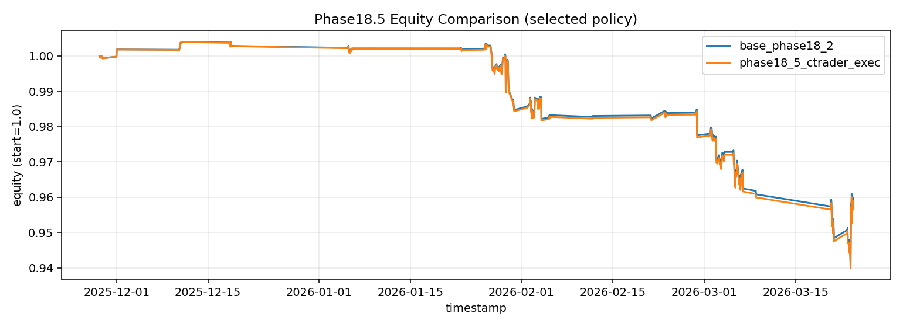

# Forex Research Pipeline

Pipeline experimental, *leak-safe* y multi-divisa para investigar representación de
regímenes de mercado, aprendizaje por refuerzo, asignación de portafolio y ejecución
simulada sobre datos FX.


> [!IMPORTANT]
> Este repositorio documenta investigación en curso. No ejecuta órdenes reales y la
> evidencia reciente **no supera** los guardrails definidos. No es asesoría financiera
> ni una estrategia lista para producción.

## Estado actual

El proyecto ya implementa el recorrido completo desde datos M1 hasta un motor de
portafolio con checkpoint congelado, backtest reciente, simulación de ejecución tipo
cTrader y servicio de *paper trading*.

La última evaluación registrada, ejecutada el **25 de marzo de 2026**, terminó
técnicamente con éxito, pero el resultado financiero fue negativo:

| Ventana | Observaciones | Retorno neto simulado | Sharpe anualizado | Max drawdown | Guardrail |
|---|---:|---:|---:|---:|---|
| 90 días | 282 | -4,44 % | -6,80 | -6,20 % | `FAILED` |
| 120 días | 317 | -4,33 % | -6,13 | -6,37 % | `FAILED` |

Las cifras corresponden a la capa de ejecución simulada cTrader, con costos y
*slippage*. Una validación ciega anterior de la fase 18.3 emitió `GO_PAPER`, pero la
evidencia reciente tiene prioridad: el sistema debe seguir en investigación y
*paper-only*.

Consulta [Resultados y roadmap](docs/RESULTS_AND_ROADMAP.md) para el detalle, los
criterios de avance y el trabajo pendiente.

## Arquitectura

```mermaid
flowchart LR
    A["M1 raw"] --> B["Fase 1<br/>M1 → H1"]
    B --> C["Fases 2–6<br/>segmentos, tokens y regímenes"]
    C --> D["Fases 7–9<br/>detección y multitarea"]
    D --> E["Fases 10–12<br/>decisión y RL offline"]
    E --> F["Fases 13–15<br/>pipeline, hardening y benchmark"]
    F --> G["Fase 16<br/>estado multi-divisa"]
    G --> H["Fases 17–18<br/>portafolio y CTDE"]
    H --> I["Fase 18.5<br/>ejecución cTrader"]
    I --> J["Fases 19–21<br/>paper live y guardrails"]
```



Principios aplicados a lo largo del flujo:

- particiones temporales estrictas y *walk-forward*;
- escaladores, embeddings y clustering ajustados solo con entrenamiento;
- auditorías contra *look-ahead* y separación mediante *purged gaps*;
- costos de transacción y escenarios `x1/x2/x3`;
- límites de leverage, drawdown, turnover y *kill switches*;
- ejecución exclusivamente simulada.

## Qué está implementado

| Bloque | Fases | Alcance | Estado |
|---|---|---|---|
| Datos | 1 | Resample M1→H1, gaps, integridad y manifiestos | Implementado |
| Representación | 2–6 | Segmentación, embeddings, transferencia, secuencias y regímenes | Implementado |
| Predicción | 7–9 | Detector online, *next-token*, dos etapas y multitarea | Implementado |
| Decisión | 10–12 | Motor causal, RL offline y leverage dinámico | Implementado |
| Robustez | 13–15 | CLI E2E, auditoría temporal, costos y benchmark de 10 pares | Implementado |
| Portafolio | 16–18 | Estado contextual, meta-portafolio y multi-agente CTDE | Implementado |
| Ejecución | 18.5–21 | Margen/leverage cTrader, paper-live, guardrails y top engine | Implementado, no aprobado |

La navegación completa por fase está en [`phases/`](phases/).

## Estructura del repositorio

```text
.
├── phases/                  # Código, notebooks y documentación por fase
├── docs/
│   ├── RESULTS_AND_ROADMAP.md
│   └── assets/              # Evidencia visual seleccionada
├── .github/workflows/       # Validación estructural y sintáctica
├── requirements.txt
├── SECURITY.md
└── README.md
```

Esta edición pública conserva la lógica de investigación y los notebooks, pero omite
los 4,1 GB de artefactos locales:

- datos M1/H1 y archivos Parquet;
- outputs de entrenamiento y backtest;
- checkpoints y modelos (`.pt`, `.pkl`, `.joblib`);
- credenciales `.env`, tokens OAuth y metadatos de cuenta;
- cachés, logs y archivos temporales.

## Instalación

Se recomienda Python 3.11 o superior y un entorno virtual aislado:

```bash
git clone https://github.com/cristo2401/forex-research-pipeline.git
cd forex-research-pipeline

python -m venv .venv
source .venv/bin/activate
python -m pip install --upgrade pip
python -m pip install -r requirements.txt
```

PyTorch puede requerir una instalación específica para tu versión de CUDA. Consulta
su instalador oficial antes de ejecutar entrenamientos con GPU.

## Datos y reproducibilidad

El contrato mínimo de entrada para M1 es:

| Campo | Tipo esperado | Descripción |
|---|---|---|
| `timestamp` o `dt` | datetime UTC | Apertura de la vela |
| `open` | float | Precio de apertura |
| `high` | float | Máximo |
| `low` | float | Mínimo |
| `close` | float | Cierre |
| `volume` | float, opcional | Volumen disponible |

Los datos no se distribuyen por tamaño y posibles restricciones de licencia. Coloca
tus archivos locales bajo `data/` o pasa rutas explícitas a cada CLI.

Ejemplo de construcción H1:

```bash
python phases/phase01_data_engineering/build_h1_dataset.py \
  --input_dir data/parquet_all \
  --output_dir data/h1 \
  --timezone UTC \
  --fx_only 1
```

El pipeline completo de las fases 13–21 también necesita modelos congelados generados
por fases previas. Por ello, la reproducción integral todavía no es de un solo comando;
esta limitación está registrada en el roadmap.

## Paper trading con cTrader

Solo las fases 19–21 usan la API de cTrader. Crea el archivo local de entorno a partir
del ejemplo:

```bash
cp phases/phase19_ctrader_paper_live/.env.example \
   phases/phase19_ctrader_paper_live/.env
```

Completa las variables únicamente en `.env`. Ese archivo está ignorado por Git.
No uses cuentas reales: el flujo publicado está diseñado para demo, *shadow mode* y
*paper trading*.

## Validación rápida

Sin descargar datos ni modelos puedes comprobar la integridad básica del repositorio:

```bash
python -m compileall -q phases
python -m json.tool phases/phase09_multitask_patterns/models_registry/phase9_models_registry.json >/dev/null
```

## Trabajo pendiente prioritario

1. Diagnosticar la degradación observada en las ventanas recientes.
2. Recuperar desempeño neto positivo fuera de muestra bajo costos `x1/x2/x3`.
3. Repetir evaluación *rolling* sin retocar el holdout y exigir guardrail `PASSED`.
4. Completar una observación paper-live sostenida con métricas de estabilidad.
5. Publicar un dataset mínimo anonimizado y checkpoints reproducibles.
6. Fijar dependencias, agregar pruebas unitarias y eliminar supuestos históricos de
   rutas/artefactos entre las primeras fases.
7. Mantener deshabilitada cualquier ejecución real mientras no se cumplan los criterios
   anteriores.

## Resultados recientes

La curva de 120 días muestra por qué el guardrail permanece cerrado:



No se han seleccionado únicamente los experimentos favorables para esta presentación.
El objetivo del repositorio es que el avance, los fallos y las decisiones de riesgo
queden auditables.

## Aviso

Este software se publica con fines educativos y de investigación. Los mercados
financieros implican riesgo de pérdida. No hay garantías de rentabilidad y ninguna
parte del repositorio debe interpretarse como recomendación de inversión.
