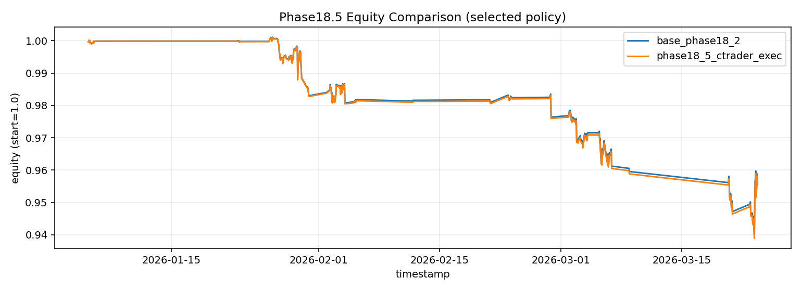

# Resultados y roadmap

Última actualización de evidencia: **25 de marzo de 2026**.

## Resumen ejecutivo

El proyecto alcanzó una implementación E2E hasta la fase 21:

- preparación de datos y representación causal;
- selección multi-divisa;
- construcción de estado de portafolio;
- entrenamiento CTDE y exportación de checkpoint;
- inferencia congelada;
- simulación de ejecución con margen, costos y *slippage*;
- guardrails y servicio paper-live.

La ingeniería del pipeline funciona, pero la estrategia actual no pasa la validación
reciente. El estado operativo correcto es `RESEARCH / PAPER_ONLY`.

## Evidencia reciente

Resultados de `phase21_full_file_recentpull_20260325_3`, política
`model_ctde_robust`, capa de ejecución cTrader:

| Métrica | 90 días | 120 días |
|---|---:|---:|
| Rango temporal | 2026-01-05 → 2026-03-23 | 2025-11-28 → 2026-03-23 |
| Ventanas | 282 | 317 |
| Retorno neto acumulado | -4,4417 % | -4,3274 % |
| Sharpe anualizado | -6,8015 | -6,1329 |
| Max drawdown | -6,1991 % | -6,3711 % |
| Trade rate | 24,11 % | 25,24 % |
| Turnover medio | 0,0726 | 0,0754 |
| Gross leverage medio | 1,7813 | 1,7913 |
| Guardrail | `FAILED` | `FAILED` |

## Cómo interpretar la aparente contradicción

La fase 18.3 produjo anteriormente una decisión `GO_PAPER` sobre un holdout ciego. Las
evaluaciones de fase 21 sobre datos más recientes fueron negativas. Esto puede ser
consistente con:

- cambio de régimen;
- sobreajuste al periodo histórico;
- sensibilidad a costos, turnover o composición del universo;
- desalineación entre el checkpoint congelado y la distribución reciente.

No se afirma todavía cuál de estas hipótesis es la causa. Deben probarse sin usar las
ventanas de 90/120 días como nuevo conjunto de entrenamiento encubierto.

## Criterios para volver a `GO_PAPER`

La siguiente iteración solo debería habilitar paper-live normal si:

- obtiene retorno neto positivo en varias ventanas temporales no solapadas;
- mantiene Sharpe positivo después de costos y *slippage*;
- pasa escenarios de costo `x1/x2/x3`;
- respeta límites de drawdown, turnover y exposición;
- no presenta alertas de fuga temporal;
- el resultado es estable entre semillas y pares;
- el guardrail automatizado emite `PASSED`.

`GO_PAPER` no significa `GO_LIVE`.

## Roadmap

### P0 — Bloqueantes

- Auditar los runs directos de cTrader que quedaron con estado `RUNNING`.
- Reproducir los backtests recientes desde un entorno limpio.
- Aislar si la pérdida proviene de señal, asignación, turnover o ejecución.
- Congelar un nuevo protocolo de validación antes de ajustar hiperparámetros.

### P1 — Reproducibilidad

- Publicar un dataset sintético o una muestra redistribuible.
- Añadir hashes y un manifiesto de checkpoints.
- Fijar versiones exactas de dependencias y entorno CUDA.
- Incorporar tests de causalidad, splits, costos y serialización.
- Sustituir dependencias implícitas entre outputs históricos por contratos de entrada.

### P2 — Validación operativa

- Ejecutar paper-live sostenido en demo.
- Medir latencia, frescura, gaps, reintentos y divergencia entre señal y ejecución.
- Probar recuperación tras reinicio y guardrails *stale/failed*.
- Mantener un registro de decisiones reproducible por checkpoint y hash de datos.

### Fuera de alcance actual

- órdenes reales;
- custodia de credenciales de producción;
- promesas de rentabilidad;
- despliegue sin supervisión y sin kill switch.
